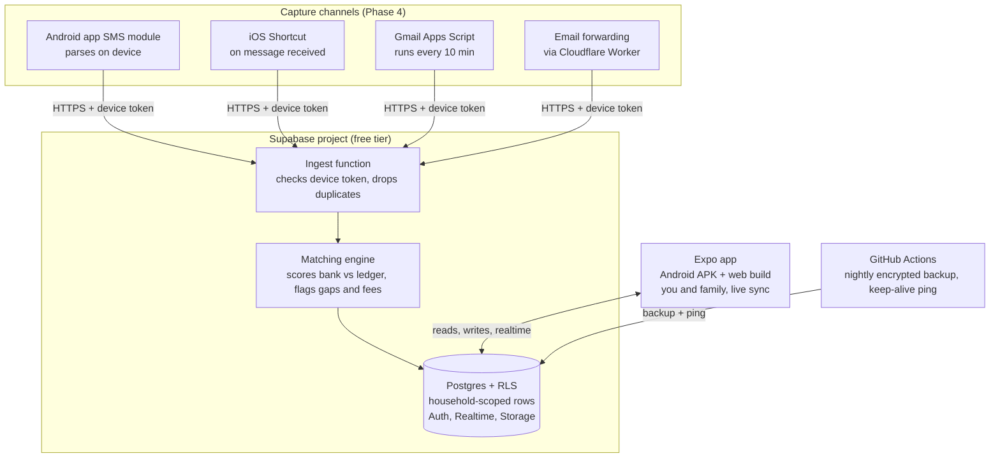

# Spendr — Family Expense, Reconciliation & FIRE Tracker

*Spend smart, together.*

Product Requirements Document · Oct 13, 2026

## 1. Overview

Spendr (tagline: "Spend smart, together.") is a free, open-source (MIT) app for Android, iOS and web where a household logs daily expenses together, reconciles every bank SMS and email against those logs, and tracks net worth and FIRE progress. It runs entirely on free tiers, so hosting costs ₹0 / $0 per month for a family.

### Problem

- Expenses are scattered across cash, UPI, cards and wallets, and no one in the family sees the full picture.
- Bank alerts arrive by SMS and email, get missed, and unexplained debits (fees, auto-debits, charges) go unnoticed for weeks.
- Savings and investments live in separate apps, so there is no single answer to "how much are we worth and are we on track?"

### Goals (v1)

1. Log an expense in under 5 seconds from a phone, with a need level and optional tags.
2. Share one household ledger with family members, with live sync.
3. Show where money goes each month — by category, need level, tag and member — compared with the previous month. Later (Phase 4), automatically capture 95%+ of bank SMS and emails and flag every bank transaction with no matching entry.
4. Show net worth, savings rate, and projections at 10, 20 and 50 years.
5. Show FIRE targets under three profiles: Very strict, Conservative and Liberal.
6. Zero recurring cost for a household on default settings.

### Non-goals (v1)

- No direct bank API or account-aggregator login (credentials and regulatory burden).
- No trading, payments or money movement — read-only tracking.
- No investment advice; projections are illustrative.
- No multi-currency conversion beyond a manual rate per account.

### Personas

| Persona | Need | Primary surface |
| --- | --- | --- |
| Primary earner (you) | Full visibility, reconciliation, FIRE planning | Android app + web |
| Partner (your wife) | Quick add, see shared spending, own accounts private if wanted | Android app (iPhone later) |
| Open-source self-hoster | Deploy own copy in 15 minutes for free | GitHub README + one-click deploy |
| Contributor | Add a parser for their bank | Parser plugin folder + tests |

## 2. Feature requirements

Seven modules; P0 items block the release of their phase, P1 items follow within a month. SMS and email reconciliation (2.5) moves to Phase 4, after public launch.

### 2.1 Expenses

| ID | Requirement | Priority |
| --- | --- | --- |
| E1 | Quick-add: amount, category, account, note, date (defaults to now). Numeric keypad opens first. | P0 |
| E2 | Types: expense, income, transfer between own accounts (transfers never count as spend). | P0 |
| E3 | Default categories (Food, Groceries, Rent/EMI, Utilities, Transport, Health, Kids, Shopping, Fees & Charges, Other), editable. | P0 |
| E4 | Recurring entries (rent, SIP, subscriptions) auto-create on schedule. | P1 |
| E5 | Split an entry across categories; attach a receipt photo (compressed under 200 KB). | P1 |
| E6 | Monthly budgets per category with 80% and 100% alerts. | P1 |
| E7 | CSV import/export of everything; export is always free and one click. | P0 |
| E8 | Offline entry on phone; syncs when back online. | P0 |

### 2.2 Need levels, tags, filters and monthly reports

Every expense carries one need level and any number of free tags, so each month can be cut by "what was really needed" as easily as by category, and compared with the month before.

**Need levels** (renamable; each category has a default, overridable per entry):

| Need level | Meaning | Default for |
| --- | --- | --- |
| Must-have | Fixed obligations you cannot skip this month | Rent/EMI, school fees, insurance, utilities |
| Necessary | Needed, but the amount is flexible | Groceries, fuel, medicines, phone bill |
| Nice-to-have | Improves life, can be cut in a tight month | Dining out, subscriptions, gadgets |
| Avoidable | Impulse or regret spend | Late-night orders, unused purchases |

| ID | Requirement | Priority |
| --- | --- | --- |
| T1 | Need level on every expense: one-tap chips in quick add, pre-filled from the category. | P0 |
| T2 | Free tags (e.g. #diwali, #goa-trip, #kids), several per entry, with autocomplete; rename and merge tags. | P0 |
| T3 | Filters: date range, member, account, category, need level, tag, amount range, text search — all combinable. | P0 |
| T4 | Saved views (e.g. "Essentials this month", "Avoidable, last 3 months"), pinnable to Home. | P1 |
| T5 | Monthly report: this month vs previous month — total, by category, need level, member and tag, with ₹ and % change. | P0 |
| T6 | Month-to-date pacing: compares this month so far with last month up to the same day, so the 13th is not compared with a full month. | P0 |
| T7 | Trends: 6- and 12-month lines per category or need level, with the 3-month average as baseline. | P1 |
| T8 | Insights: top 5 increases and decreases, any category more than 20% above its 3-month average, new recurring merchants. | P1 |
| T9 | "Monthly essentials" = 3-month average of Must-have + Necessary; shown on Home and used for budgets and the Very strict FIRE tab. | P0 |
| T10 | Month-end summary (in-app card, optional email) and report export as CSV or PDF. | P1 |

### 2.3 Household sharing

| ID | Requirement | Priority |
| --- | --- | --- |
| H1 | Create a household; invite by email link. Roles: Owner, Member, Viewer. | P0 |
| H2 | Every entry shows who added it; real-time updates to all members. | P0 |
| H3 | Accounts can be Shared or Private; private accounts count toward net worth only if the owner opts in. | P0 |
| H4 | Activity feed: who added, edited or deleted what, and when. | P1 |
| H5 | Member leaves → their private data goes with them; shared data stays. | P1 |

### 2.4 Accounts, savings and investments

| ID | Requirement | Priority |
| --- | --- | --- |
| A1 | Account types: bank, credit card, cash, wallet, loan. | P0 |
| A2 | Holdings: mutual funds, stocks, FD/RD, PPF/EPF/NPS, gold, real estate, crypto, other. Fields: invested, current value, expected return %, maturity date. | P0 |
| A3 | Net worth = assets − liabilities, snapshotted monthly for a history line. | P0 |
| A4 | Savings rate per month = (income − expense) ÷ income. | P0 |
| A5 | Optional price refresh for mutual funds (free public NAV feed) and stocks; manual value otherwise. | P1 |
| A6 | Asset allocation view (equity / debt / gold / cash / real estate). | P1 |

### 2.5 SMS and email reconciliation (Phase 4)

| ID | Requirement | Priority |
| --- | --- | --- |
| R1 | Android companion reads bank SMS (opt-in, sender allow-list) and forwards parsed fields only. | P0 |
| R2 | Gmail / Outlook connection via OAuth with read-only scope and a bank-sender filter. | P0 |
| R3 | Manual fallback: forward an email to a personal inbound address or paste SMS text. | P0 |
| R4 | Parser extracts amount, debit/credit, account last-4, merchant/reference, date, available balance. | P0 |
| R5 | Auto-match parsed transactions to manual entries; unmatched ones land in an "Unexplained" inbox. | P0 |
| R6 | Flag rules: any fee/charge keywords, any debit with no matching entry after 48 h, any balance jump that the sum of transactions does not explain. | P0 |
| R7 | Daily digest (email or push) of unexplained items; nothing is ever auto-deleted. | P1 |
| R8 | Monthly statement upload (PDF/CSV) to close gaps the alerts missed. | P1 |

### 2.6 Projections

| ID | Requirement | Priority |
| --- | --- | --- |
| P1 | Project any amount, or total net worth, at 10, 20, 30 and 50 years with a monthly contribution. | P0 |
| P2 | Show nominal and inflation-adjusted (today's money) values side by side. | P0 |
| P3 | Three return scenarios per projection (pessimistic / expected / optimistic) drawn as a band. | P0 |
| P4 | "What if" sliders: monthly SIP, step-up %, return %, inflation %. | P1 |

### 2.7 FIRE targets

| ID | Requirement | Priority |
| --- | --- | --- |
| F1 | Three tabs: Very strict, Conservative, Liberal, each with its own expense multiplier, withdrawal rate and return assumption (see 6.4). | P0 |
| F2 | For each tab: target corpus, % achieved, years to FIRE at the current savings rate, FIRE age. | P0 |
| F3 | Expenses default from the last 12 months of real data, editable. | P0 |
| F4 | Coast-FIRE number: amount needed today to reach the target by a chosen age with no new savings. | P1 |

## 3. UX and design system

The app is mobile-first, monochrome with one accent colour, and every primary action is reachable with one thumb in two taps or fewer. One token set drives Android, iOS and web, so every screen looks the same on every platform and in light and dark mode.

### 3.1 Design principles

- **One number per screen.** Each tab leads with a single headline figure (this month's spend, net worth, FIRE %).
- **Colour means something.** Neutral greys for everything; green only for income/credit, red only for debit/alerts, one accent (indigo) for actions, four muted hues reserved for need levels.
- **No dashboards of 12 cards.** Detail lives one tap deeper.
- **Numbers first.** Amounts use tabular figures so columns align, and every amount has the same format everywhere.
- **Native feel.** Platform-native sheets, haptics and back gestures; nothing that looks like a web page inside an app.

### 3.2 Design library and tooling

| Layer | Choice | Role |
| --- | --- | --- |
| App framework | Expo (React Native) with Expo Router | One codebase for Android (APK), iOS (later) and web |
| Styling engine | NativeWind (Tailwind CSS for React Native) | All styling through utility classes bound to design tokens |
| Component library | NativeWindUI (free components only) | Native-feeling primitives: text, buttons, inputs, toggles, segmented controls, sheets |
| In-house components | Built in `/components/ui` on the same tokens | Replaces any NativeWindUI Pro component (card, list, alert) so the repo stays MIT and free |
| Variants | `class-variance-authority` + `cn()` helper (clsx + tailwind-merge) | Typed size/tone variants, no ad-hoc class strings in screens |
| Icons | lucide-react-native | One thin line-icon set on all platforms, including web |
| Font | Inter via `@expo-google-fonts/inter` (SIL Open Font License) | Free, excellent tabular figures |
| Charts | react-native-gifted-charts (on react-native-svg) | Bars, lines, areas; works on web |
| Lists | FlashList | Smooth ledger scrolling with thousands of rows |
| Motion and haptics | react-native-reanimated, expo-haptics | Sheet transitions, light haptic on save |

**Licence check at setup:** before copying any NativeWindUI component, confirm it is in the free tier; Pro sources must never be committed to the public repo.

### 3.3 Design tokens

Tokens live in three files and nowhere else: `global.css` (CSS variables for light and dark), `tailwind.config.js` (maps variables to class names like `bg-card`, `text-muted-foreground`) and `theme/tokens.ts` (the same values for charts and native APIs that cannot read classes). Screens never use a raw hex value.

**Colour — core**

| Token | Tailwind class | Light | Dark | Use |
| --- | --- | --- | --- | --- |
| background | `bg-background` | #FAFAFA | #0E0E10 | App canvas |
| card | `bg-card` | #FFFFFF | #18181B | Cards, sheets, list surfaces |
| foreground | `text-foreground` | #18181B | #F4F4F5 | Primary text, headline numbers |
| muted-foreground | `text-muted-foreground` | #71717A | #A1A1AA | Labels, captions, secondary text |
| border | `border-border` | #E4E4E7 | #27272A | Hairlines, input outlines |
| muted | `bg-muted` | #F4F4F5 | #232326 | Chips, pressed states, skeletons |
| primary | `bg-primary` | #4F46E5 | #818CF8 | Buttons, active tab, links, FAB |
| primary-foreground | `text-primary-foreground` | #FFFFFF | #0E0E10 | Text on primary |
| destructive | `bg-destructive` | #DC2626 | #F87171 | Delete, errors |

**Colour — semantic (finance)**

| Token | Light | Dark | Use |
| --- | --- | --- | --- |
| credit | #16A34A | #4ADE80 | Income, money in, positive change in savings |
| debit | #DC2626 | #F87171 | Spend increases, alerts, over-budget |
| warning | #D97706 | #FBBF24 | 80% of budget, low-confidence items |
| need-must | #0F766E | #2DD4BF | Must-have dot, chart series |
| need-necessary | #2563EB | #60A5FA | Necessary dot, chart series |
| need-nice | #A16207 | #FACC15 | Nice-to-have dot, chart series |
| need-avoidable | #BE185D | #F472B6 | Avoidable dot, chart series |

A spend increase is shown in `debit` and a decrease in `credit`; for income and savings rows the meaning flips. The `DeltaBadge` component owns this rule so screens never decide colours.

**Typography** (Inter; all amounts use `tabular-nums`)

| Token | Size / line height | Weight | Use |
| --- | --- | --- | --- |
| display | 32 / 40 | 600 | Headline number on each tab |
| title | 20 / 28 | 600 | Screen and sheet titles |
| heading | 17 / 24 | 600 | Section headers, card titles |
| body | 15 / 22 | 400 | Default text, list rows |
| label | 13 / 18 | 500 | Chips, buttons, field labels |
| caption | 11 / 16 | 400 | Timestamps, footnotes, axis labels |

**Spacing, radius, elevation, motion, icons**

| Group | Tokens |
| --- | --- |
| Spacing (4-pt grid) | 1 = 4, 2 = 8, 3 = 12, 4 = 16, 6 = 24, 8 = 32, 12 = 48 px; screen padding 16, gap between cards 12 |
| Radius | sm 8 (inputs, chips), md 12 (cards), lg 16 (sheets), full (pills, avatars, FAB) |
| Elevation | Cards: none, 1 px `border` hairline. Sheets and FAB: one soft shadow. No other shadows. |
| Motion | fast 150 ms (press, toggle), base 250 ms (sheet, tab change), standard ease-out; all motion off when the OS "reduce motion" setting is on |
| Haptics | Light impact on save, success notification on sync of offline entries, none elsewhere |
| Icons | lucide, 20 px in rows and chips, 24 px in tab bar, stroke 1.75, colour inherits text token |
| Touch targets | Minimum 44 × 44 px |

### 3.4 Component system

Components are built in four layers; each layer may only use the layers below it.

1. **Tokens** — `global.css`, `tailwind.config.js`, `theme/tokens.ts`.
2. **Primitives** (`/components/ui`) — free NativeWindUI components plus in-house replacements: Text, Button, IconButton, TextField, Toggle, Checkbox, SegmentedControl, Select, Sheet, Dialog, Card, ListRow, Chip, Badge, Avatar, ProgressBar, Skeleton, Toast.
3. **Finance components** (`/components/finance`) — the app's own building blocks, listed below.
4. **Screens** (`/app`, Expo Router) — compose finance components; no raw `View` styling beyond layout, no raw hex, no direct `Text` from React Native.

**Finance components**

| Component | Purpose | Key props | States / variants |
| --- | --- | --- | --- |
| AmountText | Formats money with locale (₹1,23,456 / $123,456) and sign | `value`, `currency`, `size`, `tone` | size: display / body / caption; tone: neutral / credit / debit |
| MoneyKeypad | Number pad for quick add | `value`, `onChange`, `onSubmit` | default, with decimal, disabled |
| StatCard | Headline figure with label and change | `label`, `value`, `delta`, `period` | loading (skeleton), empty, normal |
| DeltaBadge | ₹ and % change vs previous period | `current`, `previous`, `kind` (spend / income) | up, down, flat, no-data |
| CategoryChip | Selectable category | `category`, `selected` | default, selected, disabled |
| NeedLevelChip | One of four need levels with coloured dot | `level`, `selected` | must / necessary / nice / avoidable × selected |
| TagChip | Free tag, removable | `tag`, `onRemove` | default, removable, add-new |
| TransactionRow | One ledger entry | `transaction`, `onPress` | expense, income, transfer; member avatar; need-level dot; pending-sync icon |
| DaySectionHeader | Date and day total in the ledger | `date`, `total` | today, yesterday, date |
| FilterBar | Active filters as removable pills plus "Filter" button | `filters`, `onChange` | empty, active, saved view |
| SavedViewPill | Pinned saved view on Home | `view` | default, active |
| MonthPicker | Month switcher with "vs previous" toggle | `month`, `compare` | compare on / off |
| CompareBarChart | This month beside last month per category | `rows` | loading, empty, normal |
| NeedLevelSplitBar | Stacked 100% bar across the four need levels | `split` | normal, empty |
| ProgressRing | FIRE progress and budget usage | `value`, `target` | under 80%, 80–100% (warning), over (debit) |
| ProjectionBandChart | Pessimistic / expected / optimistic band over years | `series`, `markers` | nominal, today's money |
| EmptyState | Friendly empty screens with one action | `title`, `action` | ledger, reports, holdings |
| ConfirmSheet | Destructive confirmations | `title`, `onConfirm` | delete entry, leave household, delete everything |

**Rules for contributors**

- New UI starts from an existing component; a new component needs a token-only implementation, all states listed above, light and dark screenshots, and an entry in the gallery.
- A hidden `/dev/gallery` route (Expo Router) renders every component in every state and both themes; it replaces Storybook at zero cost.
- Accessibility props (`accessibilityRole`, `accessibilityLabel`) are required on every pressable; amounts are read aloud as full currency ("one thousand two hundred rupees").

### 3.5 Navigation

Bottom tab bar with five tabs: **Home · Ledger · Reports · Wealth · FIRE**, plus a floating "+" button on every screen that opens the Quick add sheet. On web and tablets the bar becomes a left rail.

Reconcile joins as a sixth tab when Phase 4 ships; until then the bar has five.

### 3.6 Key screens

1. **Home** — month-to-date spend vs last month at the same day, monthly essentials, savings rate, pinned saved views, last 5 entries.
2. **Quick add (sheet)** — keypad first, then category chips (last-used first), need-level chips (pre-selected from category), tags, account, optional note. Save with one tap.
3. **Ledger** — day-grouped list with member avatar and need-level dot on each row; filter bar (member, account, category, need level, tag, amount, date) and search; save any filter as a view.
4. **Reports** — month picker with "vs previous month" on by default. Top: total and change. Below: a bar per category (this month beside last month), a need-level split (Must-have / Necessary / Nice-to-have / Avoidable), a tag table, a per-member split, and the insights list. Tap any bar to open the filtered ledger.
5. **Wealth** — net-worth line (monthly snapshots), allocation bar, holdings list, "Project" button on any holding or on the total.
6. **Projection** — inputs (amount, monthly add, step-up, return, inflation) on top; band chart below with 10/20/30/50-year markers; toggle nominal vs today's money.
7. **FIRE** — three tabs (Very strict / Conservative / Liberal); each shows target corpus, progress ring, years to go, FIRE age, and the assumptions it used.
8. **Reconcile (Phase 4)** — three segments: *Unexplained*, *Matched*, *Manual only*. Each unexplained card shows source, raw text on expand, and actions: *Create entry*, *Match to existing*, *Mark as fee / dispute*, *Ignore*.
9. **Settings** — household members, accounts, categories with default need levels, tags, saved views, theme (system / light / dark), export, delete everything; SMS/email connections arrive in Phase 4.

### 3.7 Accessibility and i18n

- WCAG AA contrast in both themes, 44 px touch targets, Dynamic Type / font scaling respected up to 200%, full keyboard support on web.
- Currency and number format from locale; strings in JSON for community translation.

## 4. Architecture and zero-cost stack

The whole system is one Supabase project, one Expo app (Android APK from GitHub Releases, web build on Cloudflare Pages), and a GitHub repo for code, CI and backups — all free tiers, no servers to run.



Alerts from phone and inbox reach one ingest function; the matching engine compares them with the family's manual entries before anything lands in the shared ledger. In Phases 0–3 only the Expo app, Postgres and GitHub Actions exist.

### 4.1 Stack

Free-tier limits below are approximate and change over time; verify them when you set up.

| Layer | Choice | Why it is free and enough | Swap-in alternative |
| --- | --- | --- | --- |
| App | Expo (React Native) + Expo Router, NativeWind + NativeWindUI (free components); see 3.2 | One codebase for Android, iOS and web | Flutter |
| Android distribution | APK via GitHub Releases (EAS Build free tier or local builds), updates via EAS Update free tier | No Play Store fee; over-the-air fixes | F-Droid |
| iPhone distribution (later) | Web build installed to home screen; native iOS build only if the Apple developer fee is accepted | Same codebase | — |
| Offline and cache | TanStack Query with persistence, expo-sqlite queue for unsynced entries | Entries saved without network, synced later | WatermelonDB |
| Forms | react-hook-form + zod | Fast, typed validation | — |
| Formatting | date-fns, Intl.NumberFormat | Locale-aware dates and ₹/$ formats | — |
| Web hosting | Cloudflare Pages (Expo web export) | Free static hosting with generous bandwidth | Vercel Hobby, Netlify |
| Database, auth, realtime | Supabase free tier (Postgres ~500 MB, magic-link + Google auth, realtime, edge functions) | A household writes ~5,000 rows a year at ~300 bytes each, so decades fit | Firebase Spark, Appwrite Cloud, Neon + Auth.js |
| Email ingest | Cloudflare Email Routing + Email Worker, or Gmail Apps Script | Both free; no Google app verification needed | Mailgun free inbound |
| SMS listener (Phase 4) | Local Expo native module inside the Android app | Same APK, no second app | Open-source SMS-forwarder apps posting to the webhook |
| Charts | react-native-gifted-charts | Works on Android, iOS and web | victory-native |
| CI, releases, backups | GitHub Actions (free for public repos) | Runs tests, builds APK, nightly encrypted DB dump | GitLab CI |
| Fund prices (India) | Public daily mutual fund NAV file | Free, no key | Manual entry |

### 4.2 Data model

| Table | Key columns |
| --- | --- |
| households | id, name, base_currency, created_at |
| members | household_id, user_id, role (owner / member / viewer) |
| accounts | id, household_id, owner_id, type, name, last4, visibility (shared / private), opening_balance |
| categories | id, household_id, name, kind (expense / income), monthly_budget |
| transactions | id, household_id, account_id, created_by, type (expense / income / transfer), amount_minor (integer paise/cents, never float), category_id, note, txn_time, source (manual / sms / email / statement), need_level (must-have / necessary / nice-to-have / avoidable), tags (text[]) |
| bank_events | id, household_id, account_id, direction, amount, ref_no, counterparty, txn_time, balance_after, parsed (jsonb), raw_text (encrypted, 30-day TTL), confidence, status (unexplained / matched / fee / disputed / ignored) |
| matches | id, bank_event_id, transaction_id, score, matched_by (auto / user) |
| holdings | id, household_id, owner_id, asset_class, name, invested, current_value, expected_return, maturity_date |
| networth_snapshots | household_id, month, assets, liabilities |
| fire_profiles | household_id, name, expense_multiplier, withdrawal_rate, real_return, current_age |
| devices | id, member_id, kind (android / ios / gmail / email), token_hash, last_seen |

All money columns are integers in minor units. Saved filters live in a `saved_views` table (id, member_id, name, filter as jsonb, pinned). Monthly reports are computed by a Postgres view grouped by month, category, need level, member and tag, so no extra storage is needed. The bank_events, matches and devices tables are created in Phase 4.

### 4.3 Server functions

- `POST /ingest` — accepts parsed fields (or raw text from email), validates token, dedupes, stores a bank_event, calls the matcher.
- `match` — runs on new bank_events and new transactions (database trigger), applies the scoring in 5.3 and the balance-gap check in 5.4.
- `digest` — daily cron: emails or pushes the unexplained list and budget alerts.
- `snapshot` — monthly cron: writes net-worth snapshots.

Everything else (CRUD for entries, accounts, holdings) uses Supabase's auto-generated API, protected by Row-Level Security.

## 5. SMS and email ingestion and reconciliation

**Scheduled for Phase 4, after public launch.** Phases 0–2 work fully without it; the design is kept here so the data model leaves room for it.

Every bank alert is captured through a free, user-owned channel, parsed into a structured transaction, and matched against the ledger; anything the bank did that you didn't log appears in the Unexplained inbox within minutes. A running-balance check also catches debits whose alert you never received at all.

### 5.1 Capture channels (all free)

| Channel | How it works | Platform | Notes |
| --- | --- | --- | --- |
| SMS module in the Android app | Listens for new SMS from allow-listed bank senders (e.g. XX-HDFCBK), parses on device, POSTs fields to the API. | Android | Distributed as APK via GitHub Releases / F-Droid, because Google Play restricts the READ_SMS permission for this use. |
| iOS Shortcuts automation | Personal automation on "Message received" containing "debited" or "credited" sends the text to the user's webhook. | iOS | No app needed; user sets it up once from a shared Shortcut link. |
| Gmail via Apps Script | A Google Apps Script in the user's own account runs every 10 min, searches label `bank-alerts`, posts new messages to the webhook, marks them processed. | Gmail | Runs under the user's own quota; avoids Google's restricted-scope verification that a public OAuth app would need. |
| Email forwarding | A mail filter auto-forwards bank emails to `<household-id>@in.yourdomain` handled by a free Cloudflare Email Worker. | Any mail provider | Works for Outlook, Yahoo, Zoho; needs a domain (or use the project's shared inbound domain). |
| Statement upload | Monthly PDF/CSV statement parsed in the browser. | Web | Closes any gap the alerts missed. |
| Paste | Paste one or many SMS/email texts into a box. | All | Zero-setup fallback. |

**OTP and promo filter:** messages containing OTP, "one time password", or no amount pattern are dropped on the device and never leave the phone.

### 5.2 Parsing

- Parsers are one file per bank or card issuer in `/parsers/<country>/<bank>.ts`, each a list of regex templates plus test fixtures of real (anonymised) messages. This is the main way the community contributes.
- Output schema: `amount, currency, direction (debit|credit), account_last4, channel (UPI|card|NEFT|IMPS|ATM|auto-debit|charge), counterparty, reference_no, txn_time, available_balance?`.
- A generic fallback parser handles unknown banks with amount + debit/credit keywords; confidence below 0.7 sends the item to review instead of auto-matching.
- Optional LLM fallback is off by default (it is not free and sends text off-device); self-hosters can plug in a local model.
- Duplicate suppression: same reference_no, or same amount + account + time within 2 minutes (SMS and email for one transaction).

### 5.3 Matching engine

Runs on every new bank transaction and every new manual entry. A candidate pair is scored and auto-matched at score ≥ 80:

| Signal | Points |
| --- | --- |
| Amount equal (± ₹1 / $0.01) | 50 |
| Same account (last-4) | 20 |
| Date within same day / ±2 days | 20 / 10 |
| Merchant or counterparty text similarity > 0.6 | 10 |

Scores 50–79 are shown as suggested matches; below 50 the bank transaction stays Unexplained.

### 5.4 Alerts that would have caught your missing deduction

1. **Unexplained debit:** any bank debit with no ledger match after 48 hours.
2. **Fee and charge detector:** keywords such as charges, fee, penalty, GST on, AMC, SMS charges, min balance, mandate, NACH, ECS, auto-debit, standing instruction → tagged "Fees & Charges" and always surfaced, even if matched.
3. **Balance gap check:** when an alert includes the available balance, the system computes `previous balance − debits + credits` since the last known balance. A difference beyond ₹1 creates a "Missing transaction" card with the gap amount and the date window it happened in — this catches debits whose own SMS or email never arrived.
4. **New mandate / new merchant:** first-ever debit from a counterparty is highlighted.
5. **Silent account:** no alerts from an active account for 30 days → reminder to upload a statement.

Each card has a **Dispute helper** that pre-fills an email to the bank with date, amount, reference number and account last-4.

### 5.5 Privacy rules for ingested data

- Only parsed fields are stored by default; raw text is kept for 30 days to allow re-parsing, then deleted (configurable).
- Full account numbers are never stored, only last-4.
- Phone and mail credentials never touch the server: Apps Script and Shortcuts run in the user's own account and push with a per-device token that can be revoked in Settings.

## 6. Projections and FIRE maths

All projections compound monthly and are shown both in future rupees and in today's money; every assumption is visible and editable on screen. Figures are illustrative, not advice.

### 6.1 Future value

With starting amount P, monthly contribution C, annual return R, annual contribution step-up g, and n months (monthly rate r = R ÷ 12):

```latex
FV = P(1+r)^{n} + C \cdot \frac{(1+r)^{n} - 1}{r}
```

With a yearly step-up g, the engine loops month by month and raises C by g each 12 months (no closed form needed in code). Today's-money value uses the real return:

```latex
R_{real} = \frac{1 + R}{1 + i} - 1
```

### 6.2 Worked example

₹10,00,000 invested once at 12% a year, 6% inflation, no further contributions:

| Horizon | Future value | In today's money |
| --- | --- | --- |
| 10 years | ₹31.1 L | ₹17.3 L |
| 20 years | ₹96.5 L | ₹30.1 L |
| 50 years | ₹28.9 Cr | ₹1.57 Cr |

The app shows this as a band: pessimistic (expected − 3 pts), expected, optimistic (expected + 2 pts).

### 6.3 FIRE target

Annual expense E (from the last 12 months of the ledger), expense multiplier m and safe withdrawal rate w:

```latex
Target = \frac{E \cdot m}{w}
```

Years to FIRE = smallest n where projected investable net worth (excluding primary home and emergency fund) ≥ Target, inflating E by i each year. FIRE age = current age + n.

Coast-FIRE (amount needed today to coast to the target by age A with no new savings):

```latex
Coast = \frac{Target}{(1 + R_{real})^{A - age}}
```

### 6.4 The three FIRE tabs

| Tab | Expense multiplier m | Withdrawal rate w | Real return | Corpus as multiple of E |
| --- | --- | --- | --- | --- |
| Very strict | 1.25 (buffer for healthcare, kids) | 3.0% | 4% | 41.7× |
| Conservative | 1.0 | 3.5% | 5% | 28.6× |
| Liberal | 1.0 | 4.0% | 6% | 25.0× |

Example: annual expense ₹12 L → targets of ₹5.0 Cr (very strict), ₹3.43 Cr (conservative), ₹3.0 Cr (liberal). All defaults are editable per household; India-centric defaults use 6% inflation, other locales ship their own defaults file.

## 7. Security, open source, roadmap and risks

Each household self-hosts its own free copy, so no central server ever holds anyone's financial data; the GitHub repo is the product.

### 7.1 Security

- Row-Level Security on every table: a row is readable only by members of its household, and private-account rows only by their owner.
- Auth by email magic link or Google sign-in; optional passkey.
- Ingest webhook uses a per-device token (hashed at rest, revocable, rate-limited to 60 requests/min).
- Optional client-side encryption of notes and raw message text with a household passphrase.
- Daily automated backup: a free GitHub Actions job dumps the database to an encrypted file in the user's private repo or Google Drive.
- "Delete everything" in Settings wipes the household in one action.

### 7.2 Open-source plan

- Licence: MIT for app and parsers; parser fixtures must be anonymised (script provided).
- Repo layout: `/apps/mobile` (Expo: Android, iOS, web), `/modules/sms-listener` (Expo native module, Phase 4), `/packages/parsers`, `/packages/engine` (matching, projections, FIRE), `/supabase` (migrations, RLS policies, edge functions), `/scripts` (Apps Script, Shortcut, email worker).
- One-click deploy button + a 15-minute setup guide with screenshots.
- Contribution path: "Add your bank" issue template → parser file + 5 fixture messages → CI runs parser tests.
- Public demo with seeded fake data, reset nightly.

### 7.3 Roadmap

1. **Phase 0 — Foundations (weeks 1–2):** schema, auth, households, RLS, quick add with need level and tags, ledger, CSV export.
2. **Phase 1 — Insights (weeks 3–4):** filters and saved views, monthly report with month-over-month comparison and pacing, trends, insights, budgets, recurring entries.
3. **Phase 2 — Wealth and FIRE (weeks 5–7):** accounts and holdings, net-worth snapshots, projections with band chart, three FIRE tabs, dark mode, web build for iPhone and desktop.
4. **Phase 3 — Public launch (week 8):** docs, demo, deploy button, announce.
5. **Phase 4 — Reconcile (weeks 9–11):** ingest API, Android companion, Apps Script, email worker, 10 bank parsers, matching engine, Unexplained inbox, balance-gap check, daily digest.

### 7.4 Success metrics

| Metric | Target |
| --- | --- |
| Median time to log an expense | < 5 s |
| Bank transactions captured automatically | ≥ 95% |
| Unexplained items resolved within 7 days | ≥ 90% |
| Monthly hosting cost per household | ₹0 |
| Banks with community parsers 6 months after launch | ≥ 30 |

### 7.5 Risks and mitigations

| Risk | Mitigation |
| --- | --- |
| Free-tier project pauses after a period of inactivity | Daily ingest traffic and a scheduled GitHub Actions ping keep it active; backups make restore easy. |
| Free-tier limits or terms change | Stack uses plain Postgres + standard web hosting; migration script to Neon or a self-hosted Postgres. |
| Bank changes SMS format | Generic fallback parser + low-confidence review queue; parser tests catch regressions. |
| Play Store blocks SMS permission | Ship APK via GitHub/F-Droid; iOS Shortcut and email paths need no app store. |
| Sensitive data leak | Parsed fields only, last-4 only, RLS, per-device tokens, optional encryption, self-hosting. |
| A NativeWindUI component used is Pro (paid) | Use free components only; rebuild anything Pro in `/components/ui` on the same tokens; licence check in PR template. |
| Users mistake projections for advice | Assumptions always visible; disclaimer on projection and FIRE screens. |

### Open questions

- Is the name Spendr free to use? Check the GitHub org/repo, a domain (e.g. spendr.app or getspendr.com), Play Store listings and an Indian trademark search before launch.

- Should private accounts be hidden entirely from other members, or show balance only?
- Ship a shared inbound email domain for users without their own domain, or require one?
- Do "Very strict / Conservative / Liberal" mean how cautious the assumptions are (current reading), or lifestyle levels such as lean vs comfortable spending?

## 8. Design agent prompts

These prompts let any AI design tool (Claude Design, v0, Figma Make, Stitch or similar) produce screen designs consistent with this PRD. Paste the master prompt once at the start of a session, then one screen prompt at a time; review each result against the checklist in 8.4 before moving on.

### 8.1 How to use

1. Start a new session in the design tool and paste the **master prompt** (8.2).
2. Paste the **screen prompts** (8.3) one by one, in order. Ask for light and dark versions of each.
3. Review each screen against the checklist (8.4); reply with fixes in the same session so the agent keeps context.
4. Export final frames to `/docs/design/` in the repo and link them from the component gallery.

### 8.2 Master prompt

```text
You are a senior product designer. Design mobile screens for "Spendr", a free, open-source household expense and wealth tracker for a couple in India. It is built with Expo (React Native) + NativeWind + NativeWindUI, so every design must be buildable with simple native components: no web-only effects, no glassmorphism, no gradients, no illustrations heavier than a single line icon.

PRODUCT
- Two people (Arjun and Meera) share one household ledger and see each other's entries live.
- Core jobs: log an expense in under 5 seconds; see this month vs last month by category, need level, tag and member; track net worth and investments; project wealth at 10/20/30/50 years; track FIRE targets in three profiles (Very strict, Conservative, Liberal).
- Every expense has one need level: Must-have, Necessary, Nice-to-have, Avoidable; plus optional free tags like #diwali, #goa-trip.

PLATFORM AND FRAME
- Android phone first, 360 × 800 dp frame; must also work on iPhone (393 × 852) and a 1280 px web layout later.
- Bottom tab bar with 5 tabs: Home, Ledger, Reports, Wealth, FIRE (lucide icons: home, list, bar-chart-3, wallet, flame). A circular "+" floating action button (56 dp, primary colour) sits bottom-right above the tab bar on every main screen and opens the Quick add sheet.
- Respect safe areas, 16 dp screen padding, 44 dp minimum touch targets.

STYLE
- Minimal, calm, monochrome with ONE accent colour. Think Apple Wallet meets Linear: lots of white space, hairline borders, no drop shadows on cards.
- One headline number per screen, large and confident.
- Colour carries meaning only: green = money in / good change, red = spend increase / alert, amber = warning, indigo = actions. Need levels use four muted hues, shown as small 8 dp dots, never as big coloured blocks.

DESIGN TOKENS (use exactly)
Colours, light / dark:
- background #FAFAFA / #0E0E10
- card #FFFFFF / #18181B
- foreground #18181B / #F4F4F5
- muted-foreground #71717A / #A1A1AA
- border #E4E4E7 / #27272A
- muted #F4F4F5 / #232326
- primary #4F46E5 / #818CF8 (text on primary: #FFFFFF / #0E0E10)
- credit #16A34A / #4ADE80
- debit #DC2626 / #F87171
- warning #D97706 / #FBBF24
- need-must #0F766E / #2DD4BF
- need-necessary #2563EB / #60A5FA
- need-nice #A16207 / #FACC15
- need-avoidable #BE185D / #F472B6
Typography: Inter. All amounts use tabular figures.
- display 32/40 semibold (headline number)
- title 20/28 semibold
- heading 17/24 semibold
- body 15/22 regular
- label 13/18 medium
- caption 11/16 regular
Spacing: 4-pt grid (4, 8, 12, 16, 24, 32, 48). Gap between cards 12.
Radius: 8 inputs and chips, 12 cards, 16 bottom sheets, full for pills, avatars and FAB.
Elevation: cards have a 1 dp border and no shadow; only sheets and the FAB get one soft shadow.
Icons: lucide, 20 dp in rows, 24 dp in tab bar, stroke 1.75.

COMPONENTS (reuse; do not invent new styles)
AmountText (₹ with Indian grouping, e.g. ₹1,23,456; credit amounts prefixed "+"), MoneyKeypad, StatCard (label, headline amount, DeltaBadge, period), DeltaBadge (arrow + ₹ and % change; red when spend goes up, green when it goes down), CategoryChip, NeedLevelChip (dot + label), TagChip (#tag, removable), TransactionRow (category icon in a 36 dp muted circle, title, category · account caption, member avatar 20 dp, need-level dot, amount right-aligned), DaySectionHeader (Today / Yesterday / date + day total), FilterBar (removable pills + "Filter" button), SavedViewPill, MonthPicker, CompareBarChart (paired bars: this month solid, last month muted), NeedLevelSplitBar (one 100% stacked bar, four need colours), ProgressRing, ProjectionBandChart (expected line with a shaded pessimistic–optimistic band), EmptyState (one line icon, one sentence, one button), ConfirmSheet, Button (primary, secondary, ghost, destructive), TextField, SegmentedControl, Sheet, Toggle, Avatar.

SAMPLE DATA (use realistic Indian household data; never lorem ipsum)
- Today is 13 Oct 2026. October spend so far ₹42,380 vs ₹38,150 by 13 Sep (+11%).
- Monthly essentials ₹51,200. Savings rate 34%. Net worth ₹48.6 L.
- Categories: Rent/EMI, Groceries, Food, Utilities, Transport, Health, Kids, Shopping, Fees & Charges.
- Entries: "BigBasket" ₹2,340 Groceries, Necessary, Meera; "Swiggy" ₹486 Food, Avoidable, Arjun; "Electricity – BESCOM" ₹1,920 Utilities, Must-have; "Petrol" ₹1,500 Transport, Necessary; "Salary" +₹1,45,000 income.
- FIRE (annual expense ₹12 L): Very strict ₹5.0 Cr, Conservative ₹3.43 Cr, Liberal ₹3.0 Cr.

DELIVERABLES FOR EVERY SCREEN
- Light and dark versions side by side.
- Default state plus the states asked for in the screen prompt (empty, loading skeleton, error or offline where relevant).
- Annotate component names on the frame so developers can map each element to the component list above.
- Do not add features, tabs or data that are not described. If something is unclear, make the simplest choice and list it under "Assumptions".

Reply "Ready" and wait for the first screen prompt.
```

### 8.3 Screen prompts

Paste one at a time after the master prompt.

**1. Home**

```text
Design the Home screen. Top: greeting "Hi Arjun" (caption) and household avatar stack (Arjun, Meera) on the right. Hero StatCard: "Spent this month" ₹42,380 with DeltaBadge "+₹4,230 (11%) vs same day last month". Below, a row of two small StatCards: "Monthly essentials ₹51,200" and "Savings rate 34%". Then a horizontal row of SavedViewPills: "Essentials this month", "Avoidable · 3 months", "#goa-trip". Then "Recent" with the last 5 TransactionRows and a "See all" ghost button. FAB and tab bar visible. States: default, empty (first launch: EmptyState "Add your first expense" with primary button), loading skeleton.
```

**2. Quick add sheet**

```text
Design the Quick add bottom sheet (opens from the FAB, 90% height). Order top to bottom: segmented control Expense / Income / Transfer; large AmountText that updates as you type (₹0 placeholder in muted-foreground); category chips in a wrapping row, last-used first, one selected; need-level chips (four NeedLevelChips, one pre-selected from the category); tags row with TagChips and an "+ Add tag" chip; account select ("HDFC Savings ••1234") and date ("Today") as compact rows; optional note field; MoneyKeypad docked at the bottom with a full-width primary "Save" button. States: empty, filled (BigBasket ₹2,340, Groceries, Necessary, #weekly), saved toast "Saved · syncs when online" for offline mode.
```

**3. Ledger**

```text
Design the Ledger screen. Top: title "Ledger", search icon button, and FilterBar showing two active pills "Meera" and "Necessary" with an "×" each, plus a "Filter" button and a "Save view" ghost button. List grouped by DaySectionHeader ("Today · ₹4,346", "Yesterday · ₹2,120", "11 Oct · ₹980") with TransactionRows showing member avatar and need-level dot. One row shows a small cloud-off icon meaning "not yet synced". Also design the Filter sheet: sections for date range, member, account, category, need level, tags, amount range, with "Reset" and primary "Apply". States: default, no results for current filters, loading.
```

**4. Reports**

```text
Design the Reports screen. Top: MonthPicker "October 2026" with a "vs September" toggle on. Hero: total ₹42,380 month-to-date with DeltaBadge and caption "Compared up to 13 Sep". Section "By category": CompareBarChart with 6 categories (this month solid foreground, last month muted), each bar tappable. Section "By need level": NeedLevelSplitBar plus a 4-row legend with amount and % change for each level (Avoidable up 38% shown in debit colour). Section "By member": two rows Arjun / Meera with amounts and small bars. Section "Tags": table rows #weekly, #kids-school, #goa-trip with amounts. Section "Insights": 3 short sentences with a small icon each, e.g. "Food is 42% above your 3-month average". States: default, a past full month (no pacing caption), not enough data (first month).
```

**5. Wealth**

```text
Design the Wealth screen. Hero: "Net worth" ₹48.6 L with DeltaBadge "+₹1.2 L this month" (credit colour). Line chart of monthly net worth for 12 months (single foreground line, no fill). Allocation: one 100% stacked bar (equity, debt, gold, cash, real estate) with legend in neutral greys plus primary for equity. Holdings list grouped "Investments" and "Accounts": rows with name, type caption, current value, and gain % (e.g. "Parag Parikh Flexi Cap · Mutual fund · ₹8,42,000 · +18.4%"). Each holding row has a "Project" text button. Top-right "+ Add" icon button. States: default, empty.
```

**6. Projection**

```text
Design the Projection screen (opened from "Project" on Wealth). Inputs in a card: starting amount ₹10,00,000, monthly add ₹25,000, yearly step-up 10%, expected return 12%, inflation 6%; each a compact row with value and a slider. SegmentedControl "Future ₹ / Today's money". ProjectionBandChart from now to 50 years with vertical markers at 10, 20, 30, 50 years. Below, a 4-row table: horizon, expected value, range (pessimistic–optimistic). Footer caption "Illustrative only. Not investment advice." States: default, today's-money toggle on.
```

**7. FIRE**

```text
Design the FIRE screen. SegmentedControl tabs: Very strict / Conservative / Liberal (Conservative selected). Hero ProgressRing 16% with "₹48.6 L of ₹3.43 Cr" in the centre. Three StatCards: "Years to FIRE 14", "FIRE age 49", "Coast FIRE by 60: reached" (credit). Assumptions card listing: annual expense ₹12 L (from last 12 months), multiplier 1.0×, withdrawal rate 3.5%, real return 5%, each editable with a chevron. Caption explaining the selected profile in one sentence. Show the Very strict tab as a second frame (₹5.0 Cr target, 10%). States: default, not enough data (fewer than 3 months of expenses).
```

**8. Settings and household**

```text
Design Settings as a grouped list: Household (members with role badges Owner / Member and "Invite" button), Accounts, Categories and need levels (each category shows its default NeedLevelChip), Tags, Saved views, Appearance (System / Light / Dark segmented control), Data (Export CSV, Backup status "Last backup today 02:00"), Danger zone ("Delete everything" in destructive). Also design the Invite sheet (email field, role select, primary "Send invite") and the ConfirmSheet for "Delete everything" requiring typing the household name.
```

**9. Onboarding**

```text
Design a 3-step onboarding: (1) Sign in: app name, one-line value statement, buttons "Continue with Google" and "Email me a link"; (2) Create or join household: two large option cards; (3) Quick setup: currency (₹ default), add first account, pick which default categories to keep, with "Finish". Minimal, no illustrations beyond a single lucide icon per step. Progress dots at top.
```

**10. Component sheet**

```text
Create one component sheet frame showing every component from the master prompt in all listed states, in light and dark, labelled with component and variant names. This sheet is the source of truth for developers building /components/ui and /components/finance.
```

### 8.4 Review checklist

- Only token colours used; no new hues, gradients or shadows on cards.
- One headline number per screen; amounts in Indian grouping with tabular figures.
- Red and green used only for meaning (spend up / down, debit / credit), never decoration.
- Every element maps to a named component from 3.4; anything new is either removed or added to the component list deliberately.
- Light and dark versions both pass WCAG AA contrast.
- Touch targets ≥ 44 dp; FAB never covers the last list row (bottom padding added).
- Empty, loading and offline states designed where the prompt asks for them.
- No features beyond this PRD (no Reconcile tab until Phase 4).
